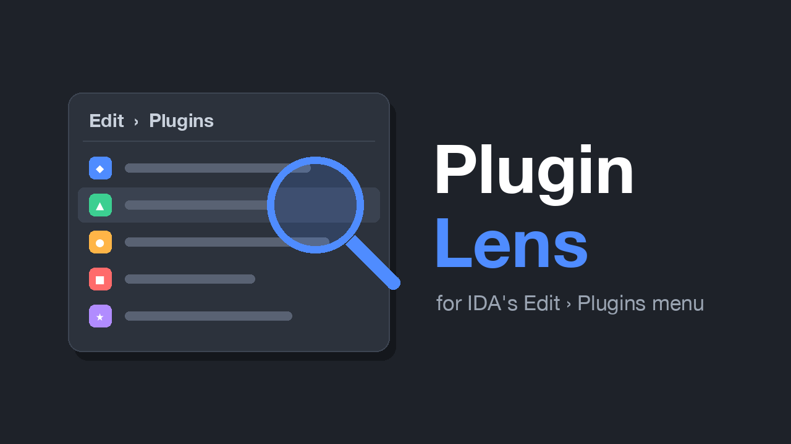
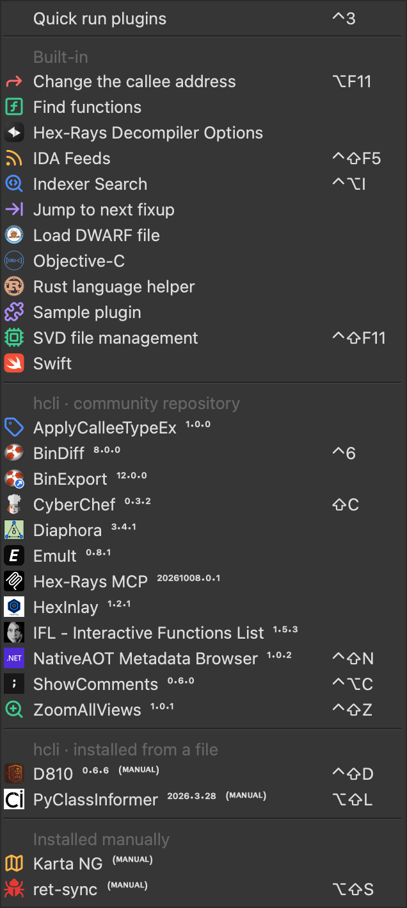

<p align="center"></p>

An IDA Pro plugin that makes **Edit › Plugins** easier to scan:

- **Icons**: most plugins never set one, so the menu is a long column of plain text. Plugin Lens uses the logo each plugin already declares in its `ida-plugin.json` (the one shown in the plugin repository), icons it comes with for IDA's built-in plugins and a few others, or an image you choose.
- **Groups**: the entries are sorted into IDA's built-in plugins, plugins installed with hcli (split by the repository they came from, or a local file), and plugins installed manually, each under a header.
- **Versions**: each plugin's version is shown after its name in small raised digits, marked *(OUT-DATED)* when hcli has a newer one, or *(MANUAL)* when no repository updates it.
- **Updates**: when hcli has newer versions, *Update plugins (N)…* at the top of the menu updates the ones you pick.



## Install

With [hcli](https://hcli.docs.hex-rays.com/):

```
hcli plugin install https://github.com/AlonSoko/ida-plugin-lens/archive/refs/heads/main.zip
```

Or copy `plugin_lens.py` into your IDA plugins folder (`~/.idapro/plugins` on macOS and Linux, `%APPDATA%\Hex-Rays\IDA Pro\plugins` on Windows).

It needs IDA 9.0 or later (tested with IDA 9.4 on macOS), and runs only in the GUI. It has no menu entry of its own.

## Where icons come from

For each entry in Edit › Plugins without an icon, in this order:

1. **Your own image**: a file in `<IDA user directory>/plugin-lens/` named after the menu entry, e.g. `Diaphora.png` (`.png`, `.jpg`, `.jpeg`, `.gif` or `.bmp`). The IDA user directory is `~/.idapro` on macOS and Linux, `%APPDATA%\Hex-Rays\IDA Pro` on Windows.
2. **The plugin's logo**: `logoPath` in the plugin's `ida-plugin.json`, an image that comes with the plugin.
3. **Icons that come with Plugin Lens**, in [`icons/`](icons): for IDA's built-in plugins, and a few plugins that don't ship a logo. Their sources and licenses are in [`icons/CREDITS.md`](icons/CREDITS.md).

Plugin Lens never downloads images.

To leave an entry without an icon, create an empty file named after it with the extension `.none`, e.g. `EmuIt.none`.

Images are padded to a square and scaled down, so a wide logo is shown whole but small. For those, your own image usually looks better.

Icons that a plugin sets itself are never replaced, and nothing in the plugins is changed.

## Groups

| Group | Plugins |
|---|---|
| Built-in | the plugin file is in IDA's own `plugins` folder |
| hcli · *name* repository | installed with hcli from that plugin repository, e.g. `community` or `hexrays`: `hcli plugin upgrade` can update them |
| hcli · installed from a file | installed with hcli from a local folder or `.zip`: no updates from a repository |
| Installed manually | everything else, e.g. single-file plugins copied into the plugins folder |

Entries that aren't plugins (*Quick run plugins*) stay at the top. Within each group, entries are alphabetical.

A plugin installed with hcli is one whose folder has an `ida-plugin.json`. Where it came from is what `hcli plugin status` reports. Plugin Lens asks hcli through hcli's own Python code, in the background, each time IDA starts; it takes about a second and downloads the plugin repositories' indexes, as any `hcli plugin` command does. The answer is saved in `plugin-lens/hcli-sources.json`, so the menu is grouped right away the next time, while hcli is asked again.

This needs IDA's Python to be able to import hcli, i.e. hcli installed with the `pip` of the Python IDA uses (`pip install ida-hcli`), not in an isolated environment (e.g. `uv tool` or `pipx`). Without that, or the first time, these plugins are in one group, *Installed with hcli*.

## Versions

| Plugin | Shown |
|---|---|
| installed with hcli from a repository | `Diaphora ³·⁴·¹`, or `Diaphora ³·⁴·¹ ⁽ᴼᵁᵀ⁻ᴰᴬᵀᴱᴰ⁾` if hcli has a newer version |
| installed with hcli from a file | `D810 ⁰·⁶·⁶ ⁽ᴹᴬᴺᵁᴬᴸ⁾` |
| installed manually | `ret-sync ⁽ᴹᴬᴺᵁᴬᴸ⁾` (and its version, if it has an `ida-plugin.json`) |
| built-in | the name only |

The version comes from the plugin's `ida-plugin.json`, and *out-dated* from hcli (`hcli plugin status`). They're written in Unicode superscript characters, which look smaller than the name: a menu entry can't mix font sizes, and on macOS IDA's menus are native. Only the text shown in the menu changes; IDA's actions keep their names.

## Updates

When hcli reports newer versions of plugins installed from a repository, **Update plugins (N)…** appears at the top of Edit › Plugins. It lists them with their installed and available versions, each with a checkbox, all checked: uncheck the ones to leave as they are, and press OK. Each is updated with hcli's own `plugin upgrade`, run through its Python code inside IDA, so it keeps to the repository the plugin came from and installs its Python dependencies. hcli's messages go to the Output window, and a summary says what was updated.

A plugin's new version is loaded only when IDA starts, so when something was updated the summary has one button, **Restart IDA now**: IDA saves the database, quits, and opens again on the same database. (Restarting is tested on macOS; on Windows and Linux IDA is started again directly.)

## Settings

In `<IDA user directory>/plugin-lens/settings.json`, e.g.:

```json
{"group_menu": true, "hcli_sources": true}
```

| Setting | Default | |
|---|---|---|
| `group_menu` | `true` | `false` keeps IDA's own order, without groups |
| `show_versions` | `true` | `false` shows the names only, without versions or tags |
| `hcli_sources` | `true` | `false` never asks hcli: all its plugins are in one group, without *out-dated* tags or updates |
| `update_action` | `true` | `false` hides *Update plugins (N)…* |

## How it works

IDA creates an action for each plugin in the menu, `Edit/Plugins/<name>`. Plugin Lens watches for these actions and sets their icon with `update_action_icon()`. To find the plugin behind an entry, it reads IDA's list of plugins (the SDK's `get_plugins()`, called through `ctypes`, as IDAPython doesn't expose it), which gives each plugin's file. Its `ida-plugin.json` is in that file's folder or a folder above it.

The groups are made by reordering the menu's items with Qt and adding the headers. As IDA may rebuild the menu, this is done again each time it opens.

If IDA's list of plugins can't be read, only your own images are used, and the menu isn't grouped.

## License

MIT, except the images in [`icons/`](icons): see [`icons/CREDITS.md`](icons/CREDITS.md).
