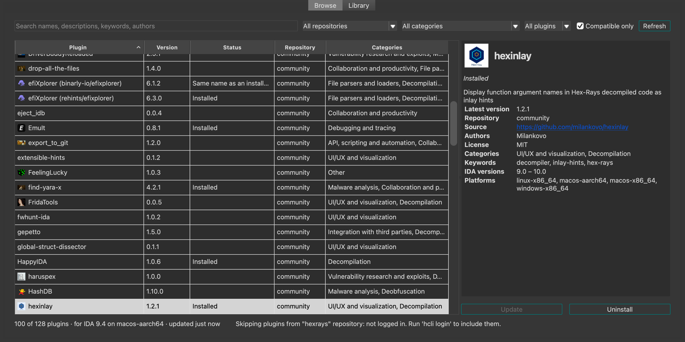

<p align="center"></p>

An IDA Pro plugin that makes **Edit › Plugins** easier to scan, and adds a small plugin marketplace:

- **Icons**: most plugins never set one, so the menu is a long column of plain text. Plugin Lens uses the logo each plugin already declares in its `ida-plugin.json` (the one shown in the plugin repository), icons it comes with for IDA's built-in plugins and a few others, or an image you choose.
- **Groups**: the entries are sorted into IDA's built-in plugins, plugins installed with hcli (split by the repository they came from, or a local file), and plugins installed manually, each under a header.
- **Versions**: each plugin's version is shown after its name in small raised digits, marked *(OUT-DATED)* when hcli has a newer one, or *(MANUAL)* when no repository updates it.
- **Updates**: when hcli has newer versions, *Update plugins (N)…* at the top of the menu updates the ones you pick.
- **Marketplace**: *Plugin marketplace…* opens a window to browse every plugin in hcli's repositories (search, filter, sort, see the details, install), and to list every plugin you have installed (update, uninstall, show in Finder).


## Install

With [hcli](https://hcli.docs.hex-rays.com/):

```
hcli plugin install https://github.com/AlonSoko/ida-plugin-lens/archive/refs/heads/main.zip
```

Or copy `plugin_lens.py`, the `pluginlens` folder and the `icons` folder into your IDA plugins folder (`~/.idapro/plugins` on macOS and Linux, `%APPDATA%\Hex-Rays\IDA Pro\plugins` on Windows).

It needs IDA 9.0 or later (tested with IDA 9.4 on macOS), and runs only in the GUI. Its window opens from *Plugin marketplace…* at the top of Edit › Plugins, or View › Open subviews.

## Where icons come from

For each entry in Edit › Plugins without an icon, in this order:

1. **Your own image**: a file in `<IDA user directory>/plugin-lens/` named after the menu entry, e.g. `Diaphora.png` (`.png`, `.jpg`, `.jpeg`, `.gif` or `.bmp`). The IDA user directory is `~/.idapro` on macOS and Linux, `%APPDATA%\Hex-Rays\IDA Pro` on Windows.
2. **The plugin's logo**: `logoPath` in the plugin's `ida-plugin.json`, an image that comes with the plugin.
3. **Icons that come with Plugin Lens**, in [`icons/`](icons): for IDA's built-in plugins, and a few plugins that don't ship a logo. Their sources and licenses are in [`icons/CREDITS.md`](icons/CREDITS.md).

The menu's icons are never downloaded. (The marketplace's Browse tab does download logos, see [below](#logos).)

To leave an entry without an icon, create an empty file named after it with the extension `.none`, e.g. `EmuIt.none`.

Images are padded to a square and scaled down, so a wide logo is shown whole but small. For those, your own image usually looks better.

Icons that a plugin sets itself are never replaced, and nothing in the plugins is changed.

## Groups

| Group | Plugins |
|---|---|
| Built-in | the plugin file is in IDA's own `plugins` folder |
| hcli · *name* repository | installed with hcli from that plugin repository, e.g. `community` or `hexrays`: `hcli plugin upgrade` can update them |
| hcli · installed from a file | installed with hcli from a local folder or `.zip`: no updates from a repository |
| Installed manually | everything else, e.g. single-file plugins copied into the plugins folder |

Entries that aren't plugins (*Quick run plugins*) stay at the top. Within each group, entries are alphabetical.

A plugin installed with hcli is one whose folder has an `ida-plugin.json`. Where it came from is what `hcli plugin status` reports. Plugin Lens asks hcli through hcli's own Python code, in the background, each time IDA starts; it takes about a second and downloads the plugin repositories' indexes, as any `hcli plugin` command does. The answer is saved in `plugin-lens/hcli-sources.json`, so the menu is grouped right away the next time, while hcli is asked again.

This needs IDA's Python to be able to import hcli, i.e. hcli installed with the `pip` of the Python IDA uses (`pip install ida-hcli`), not in an isolated environment (e.g. `uv tool` or `pipx`). Without that, or the first time, these plugins are in one group, *Installed with hcli*.

## Versions

| Plugin | Shown |
|---|---|
| installed with hcli from a repository | `Diaphora ³·⁴·¹`, or `Diaphora ³·⁴·¹ ⁽ᴼᵁᵀ⁻ᴰᴬᵀᴱᴰ⁾` if hcli has a newer version |
| installed with hcli from a file | `D810 ⁰·⁶·⁶ ⁽ᴹᴬᴺᵁᴬᴸ⁾` |
| installed manually | `ret-sync ⁽ᴹᴬᴺᵁᴬᴸ⁾` (and its version, if it has an `ida-plugin.json`) |
| built-in | the name only |

The version comes from the plugin's `ida-plugin.json`, and *out-dated* from hcli (`hcli plugin status`). They're written in Unicode superscript characters, which look smaller than the name: a menu entry can't mix font sizes, and on macOS IDA's menus are native. Only the text shown in the menu changes; IDA's actions keep their names.

## Updates

When hcli reports newer versions of plugins installed from a repository, **Update plugins (N)…** appears at the top of Edit › Plugins, and a line in the Output window says which, once per session, e.g. `[Plugin Lens] 1 plugin update: Type Yanker 1.0.0 → 1.1.0. Update it from Edit › Plugins › Update plugins (1)…`. It lists them with their installed and available versions, each with a checkbox, all checked: uncheck the ones to leave as they are, and press OK. Each is updated with hcli's own `plugin upgrade`, run through its Python code inside IDA, so it keeps to the repository the plugin came from and installs its Python dependencies. hcli's messages go to the Output window, and a summary says what was updated.

To keep a plugin at the version you have, e.g. one you changed yourself, **hold** it: right-click it in the marketplace's Library tab (or use its button in the Browse tab) and pick *Hold at this version*. A held plugin isn't in *Update plugins (N)…*, *Update all* or the Output window's line, and isn't tagged *out-dated*; *Allow updates* (same places, or the Settings tab) undoes it.

A plugin's new version is loaded only when IDA starts, so when something was updated the summary has one button, **Restart IDA now**: IDA quits as with File › Exit (asking whether to save the database, as you've set it to), and opens again on the same database. If IDA doesn't quit within a minute (e.g. you cancelled), it isn't started again. (Restarting is tested on macOS; on Windows and Linux IDA is started again directly.)

## Plugin marketplace

*Plugin marketplace…* at the top of Edit › Plugins (also in View › Open subviews) opens a window with three tabs: Browse, Library and Settings.



**Browse** lists every plugin in the repositories hcli is set up with (`community`, and `hexrays` when you're logged in with `hcli login`), combined:

- **Search** names, descriptions, keywords and authors; filter by repository, category, and *All plugins*, *Not installed*, *Installed* or *Updates*; sort by any column, e.g. **Stars** (on GitHub) or **Updated** (the repository's last update).
- **Compatible only** (on by default) hides the plugins without a version for your IDA and platform, as hcli sees them.
- **Details**: description, versions, links, GitHub stars, forks and dates, Hex-Rays' badges (*Hex-Rays favourite*, plugin contest places), authors, license, categories, IDA versions, platforms, and the Python packages pip will install with it.
- **Release notes**, in the tab next to the details, fetched when you open it: the changelog the plugin repository links to, else the plugin's GitHub releases (one request to GitHub's API, which allows 60 an hour), else a `CHANGELOG.md` in its repository. For an installed plugin with an update, the releases newer than yours are marked *new*.
- **Install** a version (the latest compatible one by default), after a confirmation that says where it comes from; **Update** or **Uninstall** the installed ones.
- **Install from URL or file…** (bottom right) installs a plugin that isn't in the repositories: from a GitHub repository (its latest release), the `https://` URL of a `.zip`, a `.zip` file, or a plugin folder, as `hcli plugin install` does. With *Update it if it's already installed*, a newer version replaces the installed one.

The list is asked from hcli in the background the first time the window opens in a session, and kept in `plugin-lens/catalog.json` to be shown right away the next time. The stars, dates, badges and changelog links come with it from the data the plugin repository's site ([plugins.hex-rays.com](https://plugins.hex-rays.com)) is built from, [`combined.json`](https://hexrayssa.github.io/plugin-repository/plugins/combined.json), which it regenerates daily: one download, without GitHub's API.

**Library** lists every plugin you have installed, whatever installed it: built-in, hcli (by repository, or from a file), or manually. Search, filter by source, *Not loaded by IDA* or *Held at their version*, or *Updates only*; sort; **Update** or **Update all**, **Uninstall** (plugins installed with hcli), and **Show in Finder**. Right-click for the same, and to hold a plugin at its version (see [Updates](#updates)).

A plugin installed with hcli that IDA didn't load is marked *Not loaded*, and its tooltip says why when its `ida-plugin.json` tells (made for another platform, its entry point missing). Otherwise IDA doesn't say why: the plugin may not apply to this database (e.g. capa skips formats it doesn't analyze), or it failed when IDA started, in which case the Output window has the error.

**Export list…** saves your plugins to a JSON file, and **Import list…** installs, from such a file, the ones you don't have, e.g. on another computer or after reinstalling IDA. The plugins from a repository are installed with hcli, at the exported version if it's available for your IDA (else the latest that is), after you pick them in a list. Plugins installed from a file or manually are in the file too, but only named: you install those yourself.

Installing, updating and uninstalling run hcli's own commands (`hcli plugin install`, `upgrade`, `uninstall`), through its Python code inside IDA; hcli's messages go to the Output window. As IDA loads plugins only when it starts, the summary then offers **Restart IDA now**. Until then, the changed plugins say so (*restart IDA*).

### Logos

The Browse tab shows each plugin's logo. For an installed plugin, it's the one in Edit › Plugins. For the others, it's `logoPath` from the plugin's `ida-plugin.json`, downloaded from its GitHub repository (from the URL the plugin repository's site gives, else the default branch), once, and kept as a small PNG in `plugin-lens/logos/`. A logo that isn't found isn't asked again for a week. To download nothing, set `"fetch_logos": false`.

In both tabs, an icon that isn't the plugin's own has a small badge in its bottom-right corner: a person on a blue dot for your own image (from `plugin-lens/`), and a magnifying glass on a teal dot for an icon that comes with Plugin Lens (e.g. IDA's built-in plugins). Its tooltip, and the Browse tab's details, say where it comes from. The Edit › Plugins menu shows the icons without badges.

## Settings

In the marketplace's **Settings** tab, or in `<IDA user directory>/plugin-lens/settings.json`, e.g.:

```json
{"group_menu": true, "hcli_sources": true}
```

| Setting | Default | |
|---|---|---|
| `group_menu` | `true` | `false` keeps IDA's own order, without groups |
| `show_versions` | `true` | `false` shows the names only, without versions or tags |
| `hcli_sources` | `true` | `false` never asks hcli: all its plugins are in one group, without *out-dated* tags or updates |
| `update_action` | `true` | `false` hides *Update plugins (N)…* |
| `fetch_logos` | `true` | `false` never downloads logos for the marketplace's Browse tab |
| `update_notice` | `true` | `false` doesn't say in the Output window which plugins have updates |
| `held_plugins` | `[]` | the hcli names of the plugins held at their version (see [Updates](#updates)) |

## How it works

IDA creates an action for each plugin in the menu, `Edit/Plugins/<name>`. Plugin Lens watches for these actions and sets their icon with `update_action_icon()`. To find the plugin behind an entry, it reads IDA's list of plugins (the SDK's `get_plugins()`, called through `ctypes`, as IDAPython doesn't expose it), which gives each plugin's file. Its `ida-plugin.json` is in that file's folder or a folder above it.

The groups are made by reordering the menu's items with Qt and adding the headers. As IDA may rebuild the menu, this is done again each time it opens.

If IDA's list of plugins can't be read, only your own images are used, and the menu isn't grouped.

## License

MIT, except the images in [`icons/`](icons): see [`icons/CREDITS.md`](icons/CREDITS.md).
