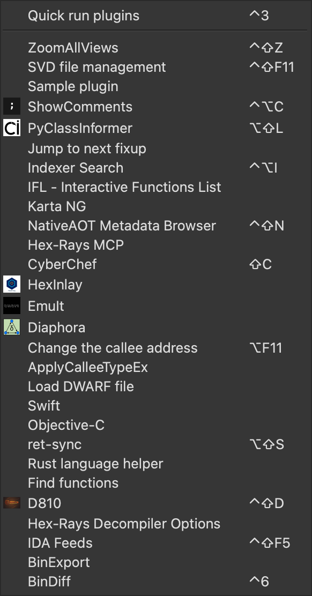

# Plugin Icons

An IDA Pro plugin that gives the entries in **Edit › Plugins** an icon.

Most plugins never set one, so the menu is a long column of plain text. Plugin Icons uses the logo each plugin already declares in its `ida-plugin.json`, the one shown in the plugin repository, or an image you choose.



## Install

With [hcli](https://hcli.docs.hex-rays.com/):

```
hcli plugin install https://github.com/AlonSoko/ida-plugin-icons/archive/refs/heads/main.zip
```

Or copy `plugin_icons.py` into your IDA plugins folder (`~/.idapro/plugins` on macOS and Linux, `%APPDATA%\Hex-Rays\IDA Pro\plugins` on Windows).

It needs IDA 9.0 or later (tested with IDA 9.4 on macOS), and runs only in the GUI. It has no menu entry of its own.

## Where icons come from

For each entry in Edit › Plugins without an icon, in this order:

1. **Your own image**: a file in `<IDA user directory>/plugin-icons/` named after the menu entry, e.g. `Diaphora.png` (`.png`, `.jpg`, `.jpeg`, `.gif` or `.bmp`). The IDA user directory is `~/.idapro` on macOS and Linux, `%APPDATA%\Hex-Rays\IDA Pro` on Windows.
2. **The plugin's logo**: `logoPath` in the plugin's `ida-plugin.json`.

To leave an entry without an icon, create an empty file named after it with the extension `.none`, e.g. `EmuIt.none`.

Images are padded to a square and scaled down, so a wide logo is shown whole but small. For those, your own image usually looks better.

Icons that a plugin sets itself are never replaced, and nothing in the plugins is changed.

## How it works

IDA creates an action for each plugin in the menu, `Edit/Plugins/<name>`. Plugin Icons watches for these actions and sets their icon with `update_action_icon()`. To find the plugin behind an entry, it reads IDA's list of plugins (the SDK's `get_plugins()`, called through `ctypes`, as IDAPython doesn't expose it), which gives each plugin's file. Its `ida-plugin.json` is in that file's folder or a folder above it.

If that list can't be read, only your own images are used.

## License

MIT
